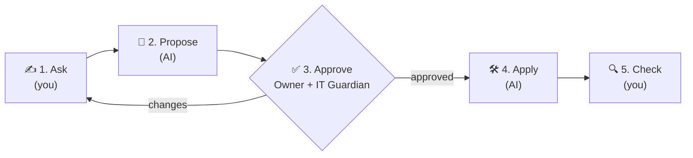

# ODD: One-Doc Driven Development

**One request. One file. No approval, no apply.**

🇧🇷 [Leia em português](README.pt-BR.md) · 📄 [Whitepaper (PDF)](docs/ODD-whitepaper-en.pdf) · 📊 [Slides (PPTX)](docs/ODD-deck-en.pptx)

ODD is a protocol that lets **anyone, including people outside IT**, safely ask AI to build software. It takes the discipline of *Spec-Driven Development* (SDD), with its PRD → Proposal → approval → apply flow, and fits all of it into **a single Markdown file** that follows the request from start to finish.

---

## Why ODD?

AI can already build software. The hard part is **what** to ask for and **who** says it's OK. Engineering teams solve that with SDD: several documents and technical roles. For people on the business side (HR, finance, operations, support), that process is too heavy, so they either ask for nothing or ask with no guardrails at all.

ODD is the middle ground: **a person writes what they want in everyday language, the AI turns it into a proposal, two people approve it, and the AI builds it.**

## The flow



| Phase | Who | What happens |
|---|---|---|
| **1. Ask** | Requester | Answers 5 simple questions: what, why, who uses it, how you'll know it worked, what must not happen. |
| **2. Propose** | AI | Writes scope, acceptance criteria, risks and an execution plan, all in plain language. |
| **3. Approve** | Owner + IT Guardian | The owner approves the **what**; the IT Guardian approves the **risk** (data, access, cost). |
| **4. Apply** | AI | Checks the approvals, builds the solution following the plan, and logs what it did. |
| **5. Check** | Requester | Tests the acceptance criteria and closes the request. |

Every phase happens **in the same file**. The `status` field in the header tells the story: `draft → in-review → approved → applied → checked`.

## Manifesto

1. **One request, one file.** Everything that matters about the change lives in one `.odd.md`.
2. **People write like people.** The Ask is in everyday language; the AI translates.
3. **AI writes, humans decide.** The AI proposes and executes; people approve.
4. **No approval, no apply.** Approval is recorded in the file, not in a chat.
5. **The file is the memory.** Who asked, why, who approved, what was done.
6. **Small by default.** If it grew too big, split it or graduate to SDD.

## Get started in 5 minutes

1. Copy [`templates/proposal.odd.md`](templates/proposal.odd.md) to `odd/ODD-0001-<name>.odd.md` in your repository.
2. Fill in **only section 1 (Ask)**.
3. Ask the AI to propose:
   - **Claude Code:** `/odd-propose odd/ODD-0001-<name>.odd.md`
   - **Any other AI:** paste the [Propose prompt](prompts/propose.md) along with the file.
4. Send the file to the **business owner** and the **IT Guardian** to fill in section 3 (via PR, email or chat; whatever counts in your company).
5. Approved? Set `status: approved` and run:
   - **Claude Code:** `/odd-apply odd/ODD-0001-<name>.odd.md`
   - **Another agent:** use the [Apply prompt](prompts/apply.md).
6. Check the result and fill in section 5.

See a complete case in [`examples/ODD-0001-vacation-tracker.odd.md`](examples/ODD-0001-vacation-tracker.odd.md).

## Roles

- **Requester:** the person with the problem. Writes the Ask and checks the result.
- **AI:** writes the Proposal and runs the Apply. Never approves.
- **Business owner:** decides whether it's worth it and whether the scope is right.
- **IT Guardian:** someone from tech who looks at data, access, cost and integrations. They don't need to review code; they review **risk**.

## SDD vs ODD

| | SDD (Spec-Driven) | ODD (One-Doc) |
|---|---|---|
| For | Development teams | Anyone |
| Artifacts | PRD, Proposal, specs, design, tasks | **1 file** |
| Who writes | PO, SM, developer | Requester (Ask) + AI (Proposal) |
| Approval | SM/PO + Tech Lead | Business owner + IT Guardian |
| Language | Technical | Everyday |
| Sweet spot | Features and systems | Small tools and automations |

ODD **does not replace** SDD. It's the on-ramp. **Graduate to SDD when** the risk is high, more than one system is involved, there's sensitive data at scale, or the proposal grows past ~2 pages.

## Repository layout

```
├── AGENTS.md / CLAUDE.md        # rules every AI agent must follow
├── .claude/commands/            # /odd-propose and /odd-apply for Claude Code
├── templates/                   # the blank ODD file (EN and PT-BR)
├── prompts/                     # Propose and Apply prompts (any AI)
├── examples/                    # a complete, filled-in case
└── docs/                        # whitepaper (PDF) and slides (PPTX)
```

## Contribute

Ideas, critiques and use cases are welcome: open an issue or a PR. If your team uses ODD, tell us how it went.

---

Created by **João Villas** · [MIT](LICENSE) license
