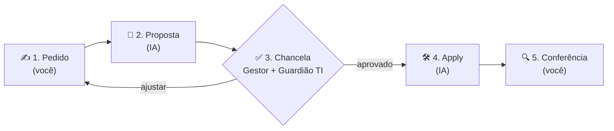

# ODD: One-Doc Driven Development

**Um pedido. Um arquivo. Sem chancela, sem apply.**

🇺🇸 [Read in English](README.md) · 📄 [Whitepaper (PDF)](docs/ODD-whitepaper-pt-BR.pdf) · 📊 [Apresentação (PPTX)](docs/ODD-deck-pt-BR.pptx)

ODD é um protocolo para **qualquer pessoa, mesmo quem não é de TI**, pedir uma solução de software à IA com segurança. Ele pega a disciplina do *Spec-Driven Development* (SDD), que trabalha com PRD → Proposal → aprovação → apply, e cabe tudo em **um único arquivo Markdown**, que acompanha o pedido do começo ao fim.

---

## Por que ODD?

A IA já consegue construir software. O problema é **o que** pedir e **quem** garante que pode. Nos times de tecnologia, o SDD resolve isso com vários documentos e papéis técnicos. Para quem está no negócio (RH, financeiro, operações, atendimento), esse processo pesa demais, e o resultado é ou não pedir nada, ou pedir sem nenhum controle.

ODD é o meio-termo: **a pessoa escreve o que quer em linguagem do dia a dia, a IA transforma em proposta, duas pessoas chancelam e a IA executa.**

## O fluxo



| Fase | Quem | O que acontece |
|---|---|---|
| **1. Pedido** | Solicitante | Responde 5 perguntas simples: o quê, por quê, quem usa, como sabe que deu certo, o que não pode acontecer. |
| **2. Proposta** | IA | Escreve escopo, critérios de aceite, riscos e plano de execução, tudo em linguagem simples. |
| **3. Chancela** | Gestor + Guardião TI | O gestor aprova o **o quê**; o Guardião TI aprova o **risco** (dados, acesso, custo). |
| **4. Apply** | IA | Confere a chancela, constrói a solução seguindo o plano e registra o que fez. |
| **5. Conferência** | Solicitante | Testa os critérios de aceite e fecha o pedido. |

Todas as fases acontecem **no mesmo arquivo**. O campo `status` no cabeçalho conta a história: `rascunho → em-chancela → aprovado → aplicado → conferido`.

## Manifesto

1. **Um pedido, um arquivo.** Tudo o que importa sobre a mudança mora num `.odd.md`.
2. **Gente escreve como gente.** O Pedido é em linguagem do dia a dia; a IA traduz.
3. **A IA escreve, o humano decide.** A IA propõe e executa; pessoas aprovam.
4. **Sem chancela, sem apply.** A aprovação fica registrada no arquivo, não numa conversa.
5. **O arquivo é a memória.** Quem pediu, por quê, quem aprovou, o que foi feito.
6. **Pequeno por padrão.** Se cresceu demais, divida ou gradue para SDD.

## Começando em 5 minutos

1. Copie [`templates/proposal.odd.pt-BR.md`](templates/proposal.odd.pt-BR.md) para `odd/ODD-0001-<nome>.odd.md` no seu repositório.
2. Preencha **só a seção 1 (Pedido)**.
3. Peça à IA para propor:
   - **Claude Code:** `/odd-propose odd/ODD-0001-<nome>.odd.md`
   - **Qualquer outra IA:** cole o [prompt Propor](prompts/propose.pt-BR.md) junto com o arquivo.
4. Envie o arquivo para o **gestor** e o **Guardião TI** preencherem a seção 3 (via PR, e-mail ou Teams; o que valer na sua empresa).
5. Aprovado? Mude `status: aprovado` e rode:
   - **Claude Code:** `/odd-apply odd/ODD-0001-<nome>.odd.md`
   - **Outro agente:** use o [prompt Apply](prompts/apply.pt-BR.md).
6. Confira o resultado e preencha a seção 5.

Veja um caso completo em [`examples/ODD-0001-controle-de-ferias.pt-BR.odd.md`](examples/ODD-0001-controle-de-ferias.pt-BR.odd.md).

## Papéis

- **Solicitante:** quem tem o problema. Escreve o Pedido e confere o resultado.
- **IA:** escreve a Proposta e executa o Apply. Nunca aprova.
- **Gestor:** dono do negócio. Decide se vale a pena e se o escopo está certo.
- **Guardião TI:** alguém de tecnologia que olha dados, acesso, custo e integrações. Não precisa revisar código; revisa **risco**.

## SDD × ODD

| | SDD (Spec-Driven) | ODD (One-Doc) |
|---|---|---|
| Para quem | Times de desenvolvimento | Qualquer pessoa |
| Artefatos | PRD, Proposal, specs, design, tasks | **1 arquivo** |
| Quem escreve | PO, SM, dev | Solicitante (Pedido) + IA (Proposta) |
| Aprovação | SM/PO + Tech Lead | Gestor + Guardião TI |
| Linguagem | Técnica | Dia a dia |
| Tamanho ideal | Features e sistemas | Ferramentas pequenas e automações |

ODD **não substitui** o SDD. É a porta de entrada. **Gradue para SDD quando:** o risco for alto, envolver mais de um sistema, dados sensíveis em escala ou a proposta passar de ~2 páginas.

## Estrutura do repositório

```
├── AGENTS.md / CLAUDE.md        # regras que qualquer agente de IA deve seguir
├── .claude/commands/            # /odd-propose e /odd-apply para Claude Code
├── templates/                   # o arquivo ODD em branco (PT-BR e EN)
├── prompts/                     # prompts Propor e Apply (para qualquer IA)
├── examples/                    # caso completo preenchido
└── docs/                        # whitepaper (PDF) e apresentação (PPTX)
```

## Contribua

Ideias, críticas e casos de uso são bem-vindos: abra uma *issue* ou um PR. Se usar ODD no seu time, conte como foi.

---

Criado por **João Villas** · Licença [MIT](LICENSE)
